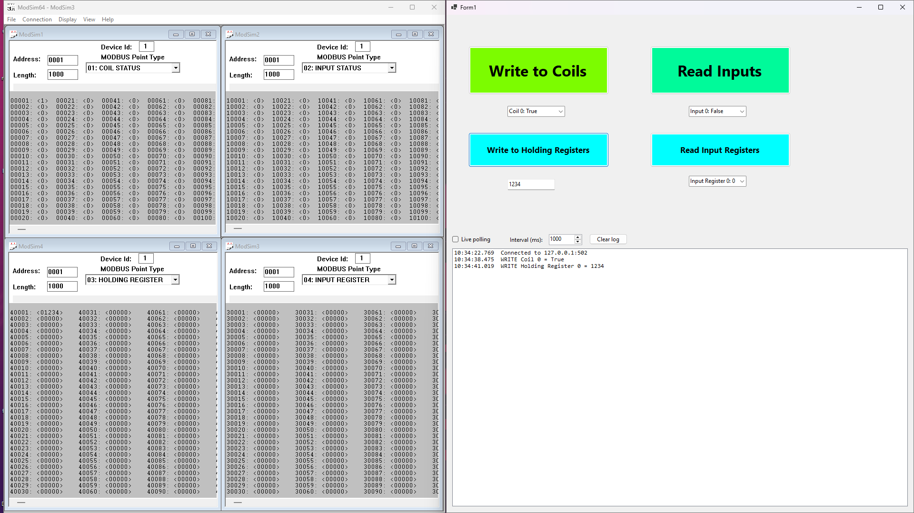
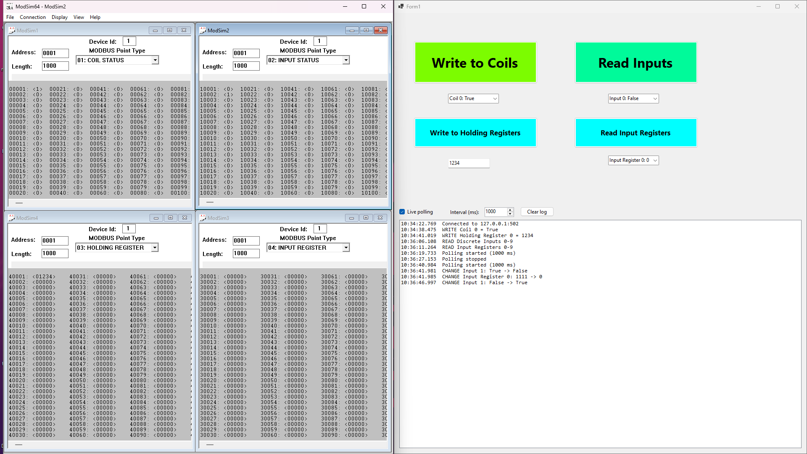
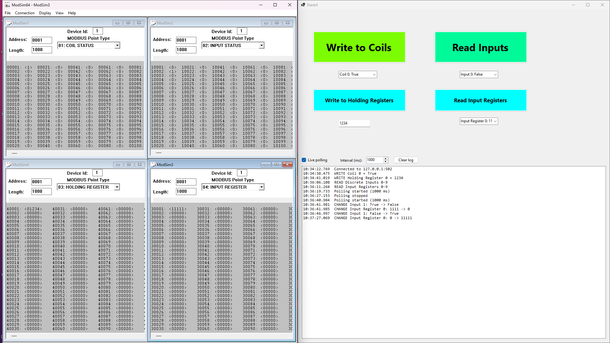
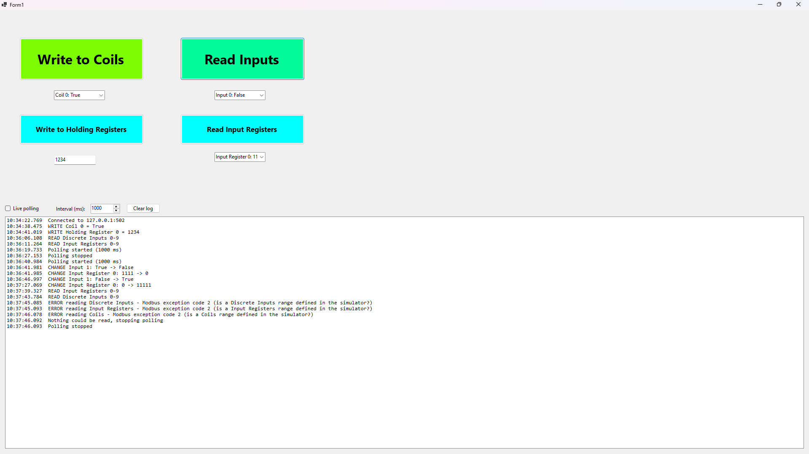

# Modbus TCP HMI for Industrial Automation

A Windows Forms HMI (human-machine interface) written in C# (.NET) that monitors and controls a Modbus TCP device. It reads and writes coils and registers, polls live values on a timer, and keeps a timestamped log of every write, read and input change. It was developed and tested against the **ModSim64** Modbus simulator.

## Screenshots

### Writing to the simulator

Toggling `Coil 0` and writing `1234` to a holding register. The log records both writes, and the values appear in the ModSim64 coil (`00001`) and holding register (`40001`) windows.



### Live polling: discrete input change

With live polling on, a discrete input flipped in the simulator (`10002`, which is `Input 1` in the app) is picked up automatically and logged as a change.



### Live polling: input register change

Changing input register `30001` in the simulator to `11111` is detected on the next poll and logged as `Input Register 0: 0 -> 11111`.



### Error handling

When the required point ranges are missing from the simulator, the app logs each failure once, stops polling, and stays open instead of crashing.



## Features

* **Write coils:** toggle a single coil on or off (Modbus function 05).
* **Write holding registers:** write a 16-bit value (0 to 65535) to holding register 0 (function 06), with input validation.
* **Read discrete inputs and input registers:** read 10 points at a time on demand (functions 02 and 04).
* **Live polling:** a configurable timer (200 to 10,000 ms) refreshes coils, discrete inputs and input registers automatically.
* **Event log:** timestamped entries for writes, manual reads and value changes. Polling logs only values that changed, so the log doesn't fill with repeats. It keeps the latest 500 lines.
* **Error handling:** connection timeouts, Modbus exception codes (for example code 2, illegal data address) and invalid input are caught and logged without crashing the app.

## How it works

|Modbus point type|Function codes used|ModSim64 address range|
|-|-|-|
|Coils|01 (read), 05 (write single)|00001 and up|
|Discrete inputs|02 (read)|10001 and up|
|Input registers|04 (read)|30001 and up|
|Holding registers|06 (write single)|40001 and up|

The code counts points from 0, while ModSim64 counts from 1. So `Coil 0` in the app is address `00001` in the simulator, and `Input 1` is address `10002`.

Design choices:

* **Async I/O:** all Modbus calls are `async`, so the window never freezes while waiting for a device.
* **One request at a time:** a `SemaphoreSlim` stops the polling timer and the buttons sending overlapping requests on the same connection.
* **Isolated reads:** each data type is read separately, so a missing range in the simulator doesn't block the other reads. Each failure is logged once until it recovers.

## Requirements

* Windows
* .NET 8 SDK (or Visual Studio with the .NET desktop workload)
* [NModbus](https://www.nuget.org/packages/NModbus) NuGet package
* A Modbus TCP server, such as ModSim64 (a simulator) or a PLC

## Setup

### 1\. Configure the simulator (ModSim64)

Start a Modbus/TCP server on port **502** from the Connection menu (menu names may vary by version), then open four windows. Each one needs Device Id **1**, Address **0001** and Length **10** or more:

|Window|Point type|
|-|-|
|1|01: COIL STATUS|
|2|02: INPUT STATUS|
|3|03: HOLDING REGISTER|
|4|04: INPUT REGISTER|

Allow the simulator through Windows Firewall if prompted.

### 2\. Run the app

1. Clone the repository and open the solution in Visual Studio.
2. Restore NuGet packages (NModbus).
3. Start the simulator first, then run the app (F5).

The app connects once at startup. If the simulator wasn't running, restart the app. A successful start logs `Connected to 127.0.0.1:502` and fills the dropdowns.

### Configuration

The connection settings are constants at the top of `Form1.cs`:

```csharp
private const string PlcIp = "127.0.0.1";
private const int PlcPort = 502;
private const byte SlaveId = 1;
private const ushort PointCount = 10;
```

Change `PlcIp` to the device's IP address to connect to a real controller.

## Using the app

|Control|What it does|
|-|-|
|**Write to Coils** + dropdown|Pick a coil in the dropdown below the button, then click to flip it on or off.|
|**Write to Holding Registers** + text box|Type a number from 0 to 65535, then click to write it to holding register 0.|
|**Read Inputs** + dropdown|Reads the 10 discrete inputs and fills the dropdown.|
|**Read Input Registers** + dropdown|Reads the 10 input registers and fills the dropdown.|
|**Live polling** + interval|Refreshes all the read values automatically at the chosen interval.|
|**Log** + **Clear log**|Timestamped record of writes, reads, changes and errors.|

## Testing it

1. Pick a coil, press **Write to Coils**, and watch the value flip in the ModSim64 Coil Status window.
2. Type a number and press **Write to Holding Registers**. It appears at address `40001`.
3. Tick **Live polling**, then edit a value in the Input Status or Input Register window in ModSim64. A `CHANGE` line appears in the log within one interval.
4. Close a point range in the simulator to see the error handling.

## 

